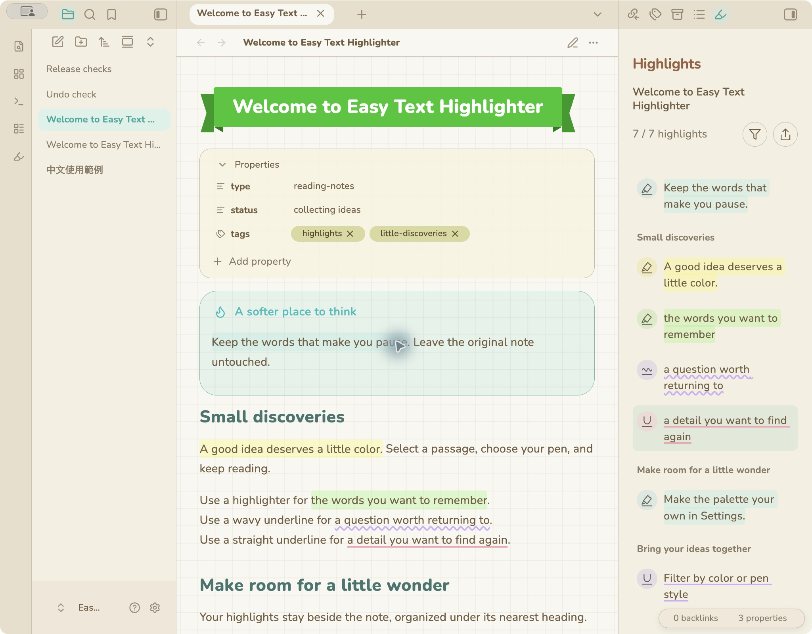
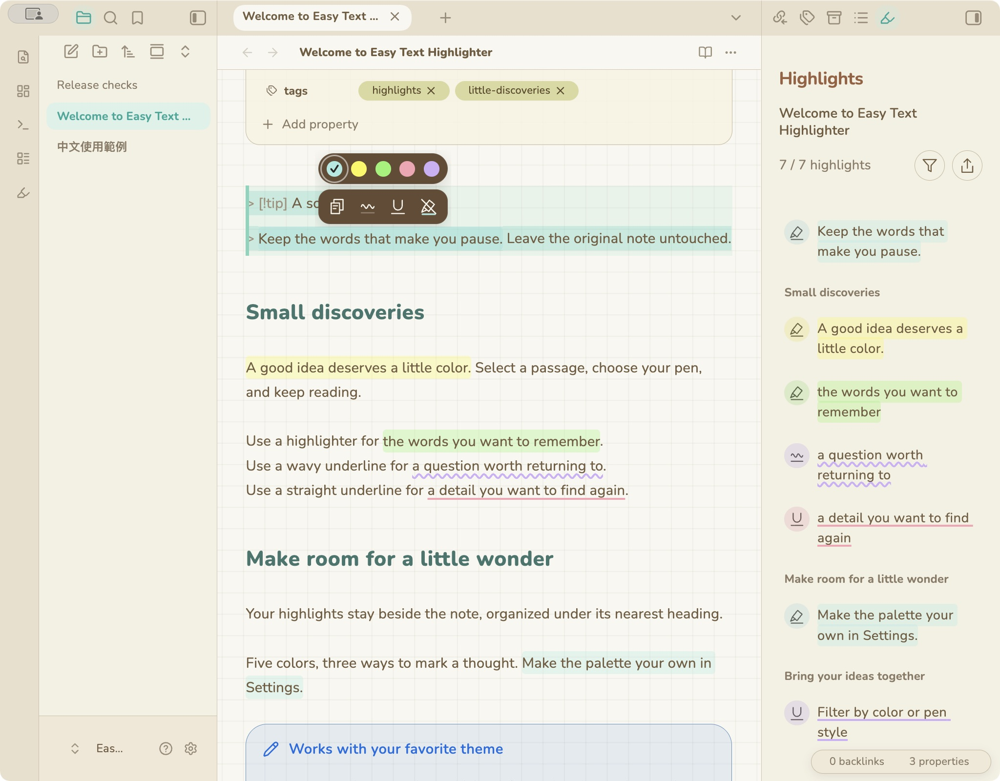
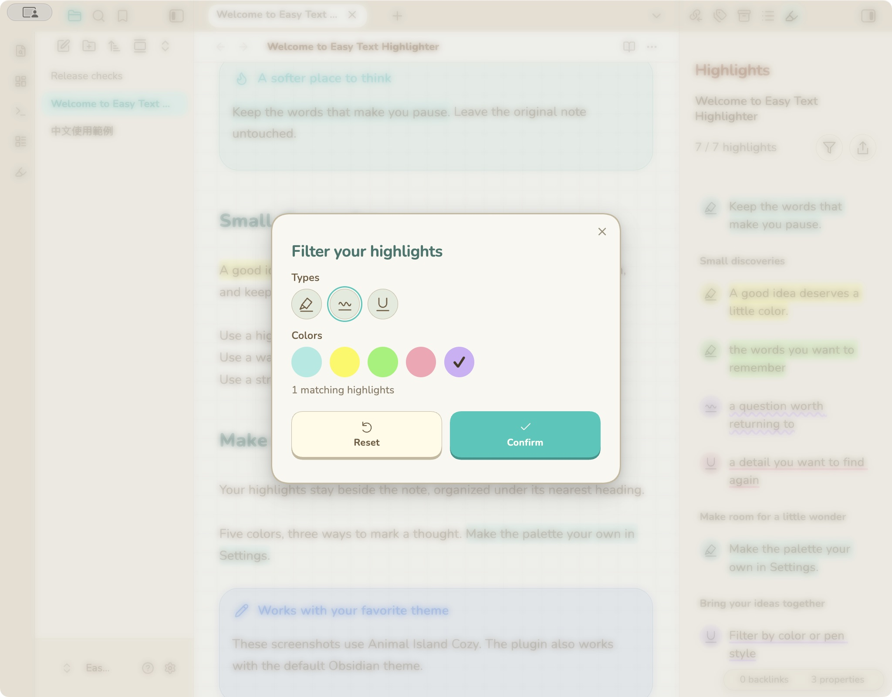
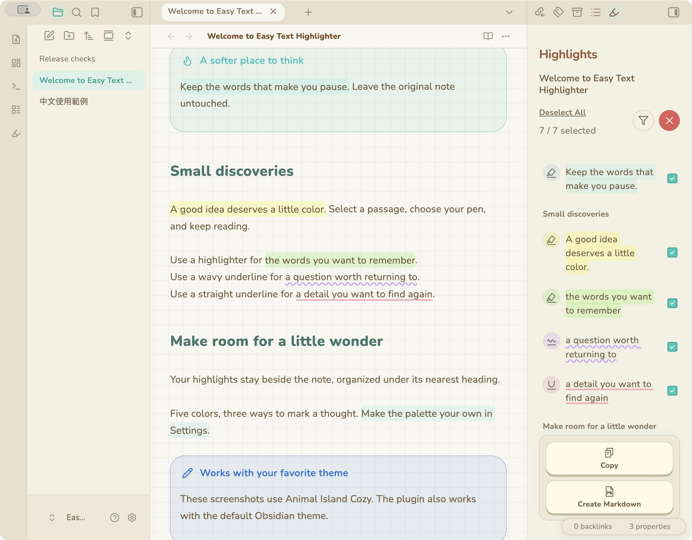
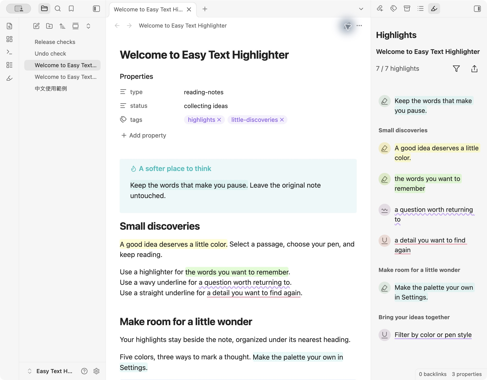

# Easy Text Highlighter

Keep the words that matter. Highlight, underline, and collect passages in Obsidian without changing your original Markdown.

[繁體中文](README.zh-TW.md) · [Get the release](https://github.com/tiffanyiong/easy-text-highlighter/releases/latest)

[Use](#use) · [Highlights](#highlights) · [Filter--export](#filter--export) · [Customize](#customize) · [Install](#install) · [Your-data](#your-data)



Shown with **[Animal Island Cozy](https://github.com/tiffanyiong/obsidian-animal-island)**, my warm, colorful Obsidian theme. The theme is optional; Easy Text Highlighter works with other themes too.

## Use

1. Select text in Reading View or Live Preview.
2. Choose **highlighter**, **wavy underline**, or **underline**. Your last color is applied immediately.
3. Use the five-color palette to change the color.

Click an existing highlight to edit it. To remove it, click the same pen with the diagonal slash. Selecting even one character inside a highlight is enough. Overlapping marks become one highlight.



## Highlights

Open **Highlights** using the ribbon icon or the command palette. The sidebar follows the active note and lists excerpts under their nearest heading, in document order. Each excerpt keeps its color and pen style. Click it to return to the passage.

## Filter & export

Filter by multiple pen styles and colors. Empty selections mean all; **Reset** restores all results.



Choose **Export**, then select excerpts using the rows or their checkboxes. All visible results start selected. **Select All / Deselect All** affects the filtered list.

- **Copy** puts a heading-organized Markdown summary on your clipboard.
- **Create Markdown** saves a new note beside the original, using a numbered name if needed.
- The red **X** exits export mode.



## Customize

Open **Settings → Easy Text Highlighter** to choose five custom colors, the default pen/color, line thickness, highlight height, and background opacity. Changing a palette color updates existing highlights and the sidebar.

Languages: English, Traditional Chinese, Simplified Chinese, Japanese, Korean, Spanish, French, German, Portuguese, and Italian. **Auto** follows Obsidian.



## Install

**Community Plugins:** directory submission is being prepared. Until the listing is approved, install from the [GitHub release](https://github.com/tiffanyiong/easy-text-highlighter/releases/latest):

1. Create `<vault>/.obsidian/plugins/easy-text-highlighter/`.
2. Download `main.js`, `manifest.json`, and `styles.css` into that folder.
3. Reload Obsidian and enable **Easy Text Highlighter** in Community plugins.

Requires Obsidian **1.14.5+**. Desktop tested on macOS. The interface adapts to narrow screens and uses a bottom sheet for mobile filters; physical iOS/Android testing is still pending.

## Your data

No account, payment, telemetry, or network requests. Highlights and preferences stay in this vault’s plugin `data.json`; your original notes are unchanged. Back up that file with your vault. Sync it if you want the same highlights on another device. Exported Markdown contains readable excerpts, not the colored annotation data.

Annotations use the original text and nearby context to follow edits. Heavily rewritten or ambiguous passages may need to be marked again. The plugin’s undo covers recent annotation changes; normal typing and paste use Obsidian’s undo.

## Development

Node.js 20 or newer. No runtime dependencies are bundled; Obsidian supplies its own APIs and CodeMirror.

```sh
npm ci
npm test
npm run lint
npm run build
npm run check
```

[Release notes](CHANGELOG.md) · [Validation](docs/VALIDATION.md) · [MIT license](LICENSE)
