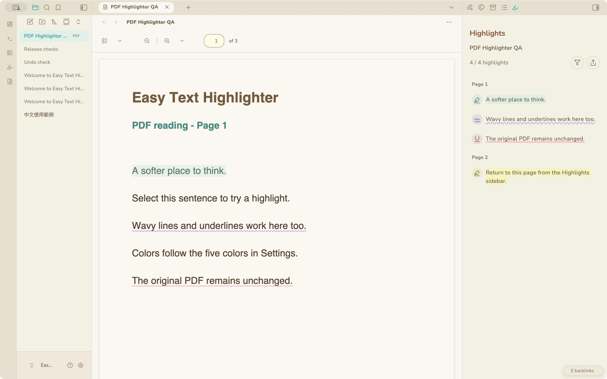

# Easy Text Highlighter

留下值得記住的文字。在 Obsidian 使用螢光底色、直線或波浪線，整理摘錄，同時保留原本的 Markdown。

[English](README.md) · [下載最新版](https://github.com/tiffanyiong/easy-text-highlighter/releases/latest)

[使用](#使用) · [PDF](#pdf) · [摘錄側欄](#摘錄側欄) · [篩選與匯出](#篩選與匯出) · [自訂](#自訂) · [安裝](#安裝) · [資料儲存](#資料儲存)


主圖使用我製作的 **[Animal Island Cozy](https://github.com/tiffanyiong/obsidian-animal-island)** 主題。主題並非必要，插件也適用於 Obsidian 預設及其他主題。

## 使用

1. 在閱讀模式或即時預覽選取文字。
2. 選擇**馬克筆、波浪線或下劃線**，立即套用上次使用的顏色。
3. 用五色色盤更換顏色。

點擊已標記的文字即可修改。按下帶斜線的同款筆圖示即可刪除；只選中標記內的一個字也能刪除整筆。重疊範圍會合併成一筆摘錄。


## PDF

在 Obsidian PDF 閱讀器選字，沿用三種筆和五色工具列。右側按頁碼整理摘錄，點擊可返回原文；複製或建立 Markdown 時附上來源 PDF 頁面連結。

PDF 原檔不會被改寫。標記另存於插件資料，啟用插件時才會顯示。PDF 需有可選取的文字層；不包含掃描辨識（OCR）。



## 摘錄側欄

從功能列圖示或命令面板開啟 **Highlights／螢光標記**。側欄跟隨目前筆記，依最近的標題與文章順序排列，保留每筆摘錄的顏色與劃線樣式。點擊摘錄即可回到原文。

## 篩選與匯出

可多選劃線類型和顏色；未選取代表全部。**重設**恢復顯示所有摘錄。


按匯出後，點文字或右側 checkbox 選取摘錄。預設全選目前結果，**全選／取消全選**只影響篩選後的列表。

- **複製**：複製按標題整理的 Markdown 摘錄。
- **建立 Markdown**：在原筆記旁建立新檔，遇到同名檔案會自動編號。頂部的來源連結可回到原筆記，也會建立 Obsidian 反向連結。
- 紅色 **X**：退出匯出模式。


## 自訂

開啟 **設定 → Easy Text Highlighter**，調整五個自訂顏色、預設劃線樣式和顏色、線寬、螢光底色高度及透明度。更改色盤會同步更新既有劃線和側欄。

支援英文、繁體中文、簡體中文、日文、韓文、西班牙文、法文、德文、葡萄牙文、義大利文。**Auto** 跟隨 Obsidian 的語言。


## 安裝

開啟 **設定 → 第三方插件 → 瀏覽**，搜尋 **Easy Text Highlighter**，安裝並啟用。也可前往 [Obsidian 插件頁面](https://community.obsidian.md/plugins/easy-text-highlighter)，按 **Add to Obsidian**。

**手動安裝：**從 [GitHub Release](https://github.com/tiffanyiong/easy-text-highlighter/releases/latest) 下載：

1. 建立 `<vault>/.obsidian/plugins/easy-text-highlighter/`。
2. 將 `main.js`、`manifest.json`、`styles.css` 放入該資料夾。
3. 重新載入 Obsidian，於第三方插件啟用 **Easy Text Highlighter**。

需要 Obsidian **1.14.5+**。已在 macOS 測試；窄螢幕介面會自動調整，手機篩選使用底部面板。iOS／Android 實機測試尚未完成。

## 資料儲存

不需帳號或付款，沒有遙測或網路請求。標記和設定儲存在此 vault 的插件 `data.json`，不修改原筆記。請連同此檔案備份；跨裝置使用時也需同步它。匯出的 Markdown 保留可閱讀的摘錄，不包含彩色標記資料。

插件透過原文與前後文尋找位置。大幅改寫或有多個相同段落時，可能需要重新標記。插件 Undo 處理近期的標記操作；輸入和貼上使用 Obsidian 原本的 Undo。

## 開發

需要 Node.js 20 以上。Obsidian API 和 CodeMirror 由應用程式提供。

```sh
npm ci
npm test
npm run lint
npm run build
npm run check
```

[更新紀錄](CHANGELOG.md) · [測試紀錄](docs/VALIDATION.md) · [MIT 授權](LICENSE)
